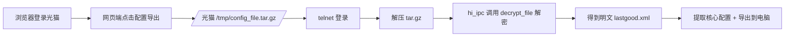
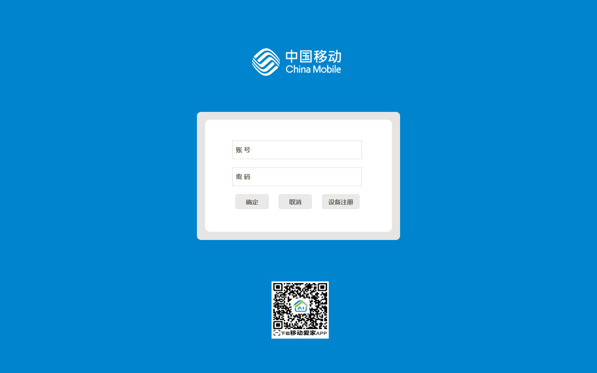
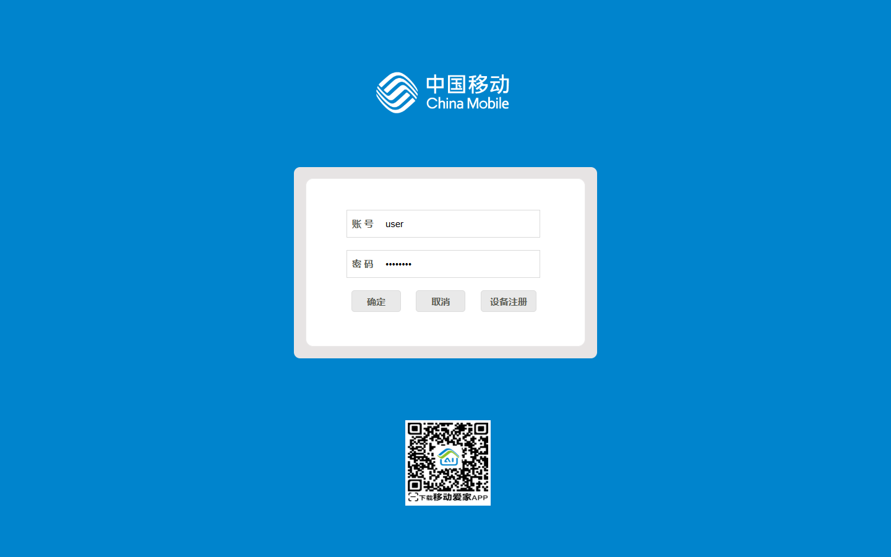
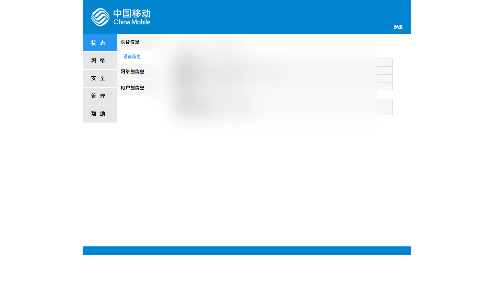
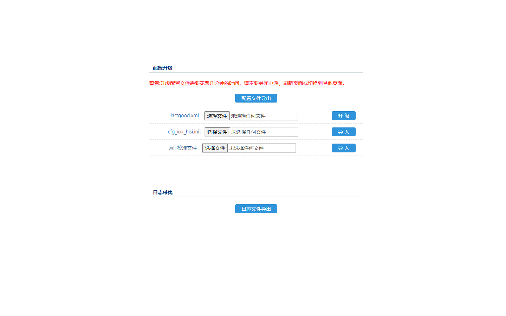

# CMCC 兆能 HN-18 光猫获取超密 / 导出配置

针对中国移动定制的**兆能 HN-18** 光猫（web 路径为 `/webcmcc/`），通过「网页导出配置包 → telnet 解密」的方式，获取光猫**超级管理员密码（超密）**，并把配置里的**核心参数**（PPPoE、VLAN、Password/LOID 认证、SN/MAC 等，属于比较通用的配置项）提取、整理后输出到电脑。

实测设备：型号 **ZN-HN18**，软件版本 **V7.0.1**（后台首页可见）。

本仓库提供一个**一键脚本**：双击运行，自动完成登录、解压、解密、导出、校验，最后输出一份核心配置汇总。唯一需要手动做的是下面的「网页端导出配置包」（脚本依赖它的产物）。

> 适用固件：`Linux hsan 5.10.0`，`/home/cmd/encrypt/decrypt_file` + `hi_ipc` 存在。其他品牌/路径（如 `/web_pages/`）不适用。

---

## 目录

- [你能得到什么](#你能得到什么)
- [准备工作](#准备工作)
  - [前置：网页端导出配置包（必做一次）](#前置网页端导出配置包必做一次)
- [一键脚本使用](#一键脚本使用)
- [核心配置参数：每一项去哪找、怎么用](#核心配置参数每一项去哪找怎么用)
- [常见问题](#常见问题)
- [原理简述](#原理简述)
- [文件说明](#文件说明)
- [免责声明](#免责声明)
- [参考与致谢](#参考与致谢)

---

## 你能得到什么

- 光猫**超密**（超级管理员账号密码，可登录 web 后台完整配置）
- 一份**核心配置汇总**：PPPoE 账号密码、VLAN ID、认证参数、SN/MAC、TR069、设备信息——比较通用，换猫、报修、备案都能直接用
- 完整配置文件：加密原文 + 解密明文（含 PPPoE、TR069、Wi-Fi、业务账号等）
- 一个可重复使用的**一键导出脚本**

流程总览：



---

## 准备工作

1. 电脑通过**网线或 Wi-Fi** 接入光猫（能打开 `192.168.1.1` 即可）
2. 一个现代浏览器（Chrome / Edge）
3. 光猫保持开机
4. **不需要安装任何软件**——脚本只依赖 Windows 自带的 PowerShell
5. 完成下面的前置步骤（网页端导出配置包，**只需做一次**，约 1 分钟）

### 前置：网页端导出配置包（必做一次）

脚本工作依赖网页端先导出的配置包，所以先手动做这一步：

1. 浏览器打开光猫首页：

   ```text
   http://192.168.1.1
   ```

   首页是空页面会自动跳转；如果没跳，**手动输入登录页地址**：

   ```text
   http://192.168.1.1/webcmcc/index.html
   ```

2. 输入账号密码，点「确定」。账号密码**印在光猫背面的标签上**，每台都不同：

   | 项目 | 取值 |
   | --- | --- |
   | 账号 | 看光猫**背面标签**（用户名一般为 `user`） |
   | 密码 | 看光猫**背面标签** |

   

   *图 1：登录页 `/webcmcc/index.html`*

   

   *图 2：填入背面标签上的账号密码（用户名一般为 `user`）后点「确定」*

3. 确认已进入管理首页：

   

   *图 3：登录成功的管理首页*

4. 访问配置导出页面，点击 **「配置文件导出」**：

   ```text
   http://192.168.1.1/webcmcc/config_upgrade.html
   ```

   

   *图 4：点击「配置文件导出」，弹窗点确定*

5. 浏览器随后可能跳到 404 页面或直接触发下载——**这都是正常的**。导出动作在点「确定」时已完成，配置包已生成在光猫的 `/tmp/config_file.tar.gz`。

**注意：**

- 光猫**只允许一个用户同时在线**，提示「当前已有一个用户已登陆」时，先把其它浏览器里登录过的页面退出
- 密码连续输错 **3 次会锁定 1 分钟**；密码含特殊字符（如 `#`），注意别漏
- telnet **不需要手动开启**，脚本连不上时会自动调用网页接口开启

完成后就可以进行下一步了。

---

## 一键脚本使用

### 使用步骤

1. 下载本仓库的 [`export_config.bat`](./export_config.bat)
2. 放到任意文件夹（建议单独建一个目录），**双击运行**
3. 等待脚本跑完（约 30 秒）
4. 窗口最后会输出**核心配置汇总**（脚本里显示为 `MIGRATION CHEAT SHEET`）；同时也写在 bat 同目录的 `export_auto/result.txt` 里

输出结构如下：

```text
===== CMCC modem lastgood.xml auto-export =====
Modem: 192.168.1.1
Connecting to 192.168.1.1:23 ... (attempt 1)
  Connected: hsan login:
  Logged in (user: user)
[1/5] Checking /tmp/config_file.tar.gz ...
  Found.
[2/5] Extracting config package to /tmp/hn18 ...
  Extraction done.
[3/5] Decrypting lastgood.xml ...
  Current config (/config/work) decrypted.
  Export package (/tmp/hn18) decrypted.
[4/5] Exporting files to ...\export_auto ...
  [1/14] /tmp/config_file.tar.gz
    OK  23611 bytes
  ...（其余 13 个文件同样 OK）
[5/5] Building migration cheat sheet ...

All done. Files in: ...\export_auto

============================================================
 MIGRATION CHEAT SHEET  (old modem -> new modem)
 Modem: 192.168.1.1    Time: 2026-11-18 16:45:55
============================================================

[Web login]
  Superadmin account  : CMCCAdmin
  Superadmin password : ********
  User account        : user
  User password       : ********

[PPPoE / Internet]
  Account             : ********@139.gd
  Password            : ********
  VLAN ID             : 41
  WAN name            : 2_INTERNET_R_VID_41
  WAN MAC             : **:**:**:**:**:**

[ONT registration]
  Auth type           : Password
  Password auth       : ********
  LOID                : (none)
  LOID password       : (none)
  SN / GPON SN        : ZNXT********
  Device MAC          : **:**:**:**:**:**

[TR069 remote management]
  ACS URL             : http://itms.***.chinamobile.com:****/...
  ...（CPE / ConnReq 账号密码）

[Device info]
  Model               : ZN-HN18
  Hardware            : V7.0
  Software            : V7.0.1
  Manufacturer        : ZNXT
  Province            : guangdong
  CTEI                : ***************

============================================================
 Full decrypted config: 02_lastgood_decrypted_current.xml
============================================================

DONE. Export folder: "...\export_auto"
Open result.txt for the admin password.
```

### 脚本做什么

1. **连接 telnet**（`192.168.1.1:23`，账号 `user` / `nE7jA%5m`）。telnet 没开时脚本会先调用光猫网页接口自动开启，最多重试 3 次
2. **检查**网页端导出的 `/tmp/config_file.tar.gz` 是否存在（缺失会打印上面的前置步骤指引）
3. **解压**到 `/tmp/hn18`（只在 tmp 目录写入）
4. **解密**：用 `hi_ipc` 调用 `decrypt_file`，分别解密当前配置和导出包里的 `lastgood.xml`
5. **导出** 14 个文件到电脑，每个文件都用光猫端 `md5sum` 逐个校验；最后从解密配置中提取核心参数，生成汇总打印到窗口并写入 `result.txt`

> 脚本**不会删除或修改**光猫上的任何原有文件，只在 `/tmp` 下新建目录和解密输出。

### 输出文件说明

`export_auto/` 目录：

| 文件 | 说明 |
| --- | --- |
| `result.txt` | **核心配置汇总**：登录账号密码、PPPoE、VLAN、Password/LOID 认证、SN/MAC、TR069、设备信息 |
| `01_config_file.tar.gz` | 网页端导出的原始配置包 |
| `02_lastgood_decrypted_current.xml` | **当前生效配置的解密明文**（核心配置汇总的主要来源） |
| `03_lastgood_decrypted_export.xml` | 导出包内 lastgood.xml 的解密明文 |
| `04` ~ `07` | lastgood.xml 加密原文（当前 / 备份 / workb） |
| `08_defaultconfig.xml` | 出厂默认配置 |
| `09` ~ `12` | factory / sysinfo / board / bob_config（设备信息来源） |
| `13_sipapp.xml`、`14_province.txt` | VoIP 与省份标识 |
| `manifest.txt` | 每个文件的 MD5 校验清单 |

> 汇总里的**每一项**都能在上面的导出文件中查到：PPPoE / VLAN / Password 认证 / SN / TR069 在 `02`（或 `03`）中；型号、版本、省份、CTEI 在 `10_sysinfo.xml` 中。

### 手动指定输出目录

默认输出到 bat 旁边的 `export_auto`。如需改到别处，先设置环境变量再运行 bat：

```powershell
$env:CMCC_OUT_DIR = "D:\my-export"
.\export_config.bat
```

cmd 下则是 `set CMCC_OUT_DIR=D:\my-export` 后再运行 bat。

---

## 核心配置参数：每一项去哪找、怎么用

这些是比较通用的核心配置项（脚本最后以 `MIGRATION CHEAT SHEET` 输出）。其中前三组（PPPoE 账号密码、VLAN ID、Password/LOID 认证）是拨号上网与设备注册的关键，需要手动填写；其余多为备案、查询或自动下发：

| 抄录项 | 在配置里的位置 | 说明 |
| --- | --- | --- |
| **PPPoE 账号 / 密码** | `WAN_CONNECTION_ATTR_TAB`（`aucWanName` 含 `INTERNET` 的那条）的 `aucUsername` / `aucPassword` | 宽带拨号的账号密码，在「宽带设置 — WAN 连接」中配置 |
| **VLAN ID** | 同一条 WAN 的 `ulVlanIdMark`（也会出现在 `aucWanName` 的 `VID_xxx`、`aucWanIfName` 末尾，如 `pppoe-wan2_41`） | 宽带业务的 VLAN 标识，同在 WAN 连接中配置（常见 41、101 等） |
| **Password 认证** | `REMOTEMGT_PASSWORD_REG_ATTR_TAB` 的 `aucPasswd`（也等于 `sysinfo.xml` 的 `reg_id`） | 运营商注册用的认证凭证，移动多数地区使用；在「远程管理 — Password 认证」中配置 |
| **LOID** | `REMOTEMGT_LOID_REG_ATTR_TAB` 的 `aucLoidName` / `aucLoidPasswd` | 另一种注册凭证，少数地区使用；在「远程管理 — LOID」中配置 |
| **SN / GPON SN** | `aucGPONSN`（= `sysinfo.xml` 的 `product_sn`） | 设备唯一序列号，背面标签上也有；用于报障、备案 |
| **设备 MAC** | `aucGateWayMac`（= `sysinfo.xml` 的 `gateway_mac`） | 设备物理地址，背面标签上也有；个别情况需克隆 |
| **超密 / 普通用户** | `SYSMNG_ACCOUNT_ATTR_TAB` 下 `aucTeleAccountName/Password`、`aucUserAccountName/Password` | 登录光猫后台的账号密码 |
| **TR069** | `REMOTEMGT_TR069_ATTR_TAB`：`aucAcsUrl`、`aucUsername/Password`、`aucConnReqUsername/Password` | 远程管理（ACS）相关配置；多数由运营商自动下发 |
| **设备信息** | `sysinfo.xml`：型号、软硬件版本、省份、CTEI、厂商 | 型号、版本、地域等标识，用于报障与核对版本 |

配置里其它值得注意的字段：

| 字段 | 含义 |
| --- | --- |
| `APP_TELNET_ACCOUNT_ATTR_TAB` 下的 `aucPassword` | telnet 密码 |
| WLAN 相关 Dir | Wi-Fi 名称与密码 |
| VoIP 相关 Dir | 语音/固话配置（本设备 `voice_num=0`，无语音口） |
| `REMOTEMGT_MIDDWARE_ATTR_TAB` 的 `aucMiddlewareURL` | 中间件地址（一般为空） |

> 小提示：`WAN MAC` 在配置里以**无分隔符**形式存储（`aucMACAddress`，如 `a1b2c3d4e5f6`），汇总里已格式化为冒号分隔；用编辑器搜索时去掉冒号即可。`SN`、`CTEI`、`TR069 CPE 账号` 这类随设备走，一般不需要手动改动；若不确定哪些必须填写，把这份核心配置发给装维最稳妥。不同地区 / 装维下发的配置不同，**以你自己运行脚本得到的结果为准**。

---

## 常见问题

### 1. 提示找不到 `/tmp/config_file.tar.gz`

说明还没做过网页端导出。按上方[前置步骤](#前置网页端导出配置包必做一次)操作一次（登录 → 打开 config_upgrade.html → 点「配置文件导出」），然后重新运行脚本。

### 2. 点了导出，浏览器跳到一个 404 页面

正常。导出动作在你点「确定」那一刻就完成了，文件在光猫 `/tmp` 下；跳转的那个 URL 只是前端逻辑，部分固件不提供直接下载。

### 3. 提示「当前已有一个用户已登陆」

光猫同时只允许一个 web 会话。把之前登录过的浏览器全部退出（或等会话超时），再重新登录。

### 4. 提示「密码错误三次，请一分钟之后重新登录」

输错密码触发了保护，等 60 秒再试。注意密码区分大小写、包含特殊字符（如 `#`）。

### 5. 脚本反复重试后仍连不上 telnet

脚本已尝试自动开启 telnet。若仍失败，可手动触发：登录光猫后访问 `http://192.168.1.1/webcmcc/telnet.html`（页面空白是正常的，它在后台发了开启请求），等几秒再运行脚本。

### 6. 提示 `hi_ipc` 或 `decrypt_file` 不存在

固件版本差异，该固件没有这套解密工具，本方法不适用。可用的固件需要同时具备 `/usr/bin/hi_ipc` 和 `/home/cmd/encrypt/decrypt_file`。

### 7. 双击 bat 后，把 PowerShell 代码当成命令乱执行

bat 文件的**换行符必须是 CRLF**。如果用记事本等工具另存为时选了 Unix 换行，cmd 会把整份文件当成一行解析。解决办法：从本仓库直接下载原始文件，或在编辑器里把换行符改回 CRLF（Windows）。

### 8. 杀毒软件拦截 bat

脚本会建立 telnet 连接、向光猫发 HTTP 请求，部分安全软件会误报。可先阅读 bat 中 `###PS###` 与 `###END_PS###` 之间的源码，确认无恶意行为后再选择放行。

### 9. 为什么脚本打印的是英文？

为了避免 Windows 控制台编码问题（中文系统默认 GBK、其它系统可能是 437/UTF-8，中文输出容易乱码），脚本**刻意使用纯 ASCII 英文输出**，`result.txt` 和 `manifest.txt` 同理——这样无论用什么代码页、被什么编辑器打开都不会损坏。看不懂某条英文提示，对照本文档即可。

> 注意：英文只解决「字符编码」问题，**解决不了换行符问题**。bat 仍然必须是 CRLF，这个由仓库里的 `.gitattributes` 保证，不要用编辑器另存为时改成 Unix 换行。

---

## 原理简述

- 光猫的运行时配置保存在 `lastgood.xml`，但为了防止用户直接读取，文件内容由 **hi_appm 加密模块**加密存储
- `/home/cmd/encrypt/decrypt_file` 是一个**模块脚本定义**（不是可直接运行的程序），描述了 `hi_decrypt_file` 函数的参数：`ifile`、`ofile`
- `hi_ipc` 是光猫上**调用各 hi_appm 模块函数的 IPC 工具**，形式为：

  ```text
  hi_ipc <脚本定义文件> -v <参数名1> <值1> <参数名2> <值2> ...
  ```

- 因此脚本的本质是：让 `hi_appm` 的 encrypt 模块把加密的 `lastgood.xml` 解密输出
- `TeleAccount` 相关字段是运营商侧的管理员账号，即俗称的「超密」

---

## 文件说明

| 文件 | 说明 |
| --- | --- |
| `export_config.bat` | **一键脚本入口**，双击运行；脚本逻辑内嵌在 `###PS###` ~ `###END_PS###` 之间 |
| `images/` | 网页前置步骤截图（登录页、填写账号密码、管理首页、配置导出页） |
| `README.md` | 本文档 |

> 修改脚本逻辑：编辑 bat 中 `###PS###` 与 `###END_PS###` 之间的内容即可，保存后直接运行，无需额外步骤。

---

## 免责声明

- 本项目**仅用于维护你自己的设备**。请确认你对目标光猫有合法管理权限（自家宽带、自购设备等）
- 请勿用于未授权的设备或网络，由此产生的任何后果由使用者自行承担
- 导出的配置文件包含宽带账号、Wi-Fi 密码、超密等**高度敏感信息**，请妥善保管，**不要上传到公开仓库、网盘或聊天群**
- 运营商固件更新后路径 / 工具可能变化，本教程不保证长期有效

---

## 参考与致谢

- 本仓库实现：一键自动化导出脚本、网页操作截图教程、导出完整性校验
- 解密方法参考：[中国移动兆能HN-18光猫获取超密(江苏）](https://linux.do/t/topic/2856701)（作者：zzzrayzzz）
